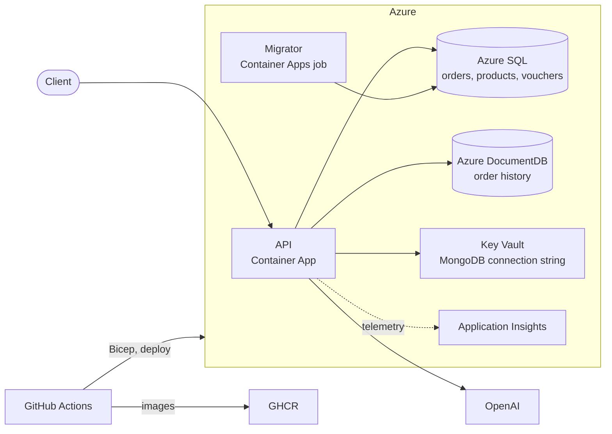

# Product API

[](https://github.com/mgiuseppe/ProductApi_DotNet10/actions/workflows/ci.yml?query=branch%3Amain+event%3Apush)

A product, order and voucher API, built to refresh .NET skills end to end:

- **.NET 10**, Clean Architecture, DDD aggregates, CQRS with MediatR
- **SQL Server** (EF Core) for the aggregates
- **MongoDB** for the order history
- **Observability** through OpenTelemetry, with Application Insights and email alerts on Azure
- **LLM** feature through `IChatClient`: a summary of an order for support operators
- **Azure** deployment: Container Apps, Azure SQL, Azure DocumentDB, Key Vault, Application Insights
- **Infrastructure as code** with Bicep deployment stacks
- **CI/CD** with GitHub Actions
- **Claude Code** for development: project rules in [CLAUDE.md](CLAUDE.md), review agents and a commit skill in [.claude/](.claude/)



## Project structure

```text
src/
  Domain/           aggregates, invariants, domain events
  Application/      one command or query per use case, with its handler
  Infrastructure/   EF Core, repositories, MongoDB, LLM client
  Api/              minimal API endpoints, exception handling, telemetry
tests/              Domain.Tests, Application.Tests, Infrastructure.Tests (Testcontainers)
infra/              Bicep templates of the Azure environments
scripts/            one-off setup of Azure and GitHub for CD
.github/workflows/  CI, CD, teardown
.claude/            Claude Code review agents and commit skill
docs/               architecture, ADRs, topic documents
```

## Run it locally

Requirements: [.NET 10 SDK](https://dotnet.microsoft.com/download) and Docker Desktop.

```bash
docker compose up -d
```

```bash
dotnet run --project src/Api
```

The first command starts SQL Server, MongoDB and the Aspire dashboard, and applies the migrations. The second starts the API (or press F5).

- API reference (Scalar): http://localhost:5224/scalar
- Traces, metrics and logs (Aspire dashboard): http://localhost:18888


The order summary needs an OpenAI key: `dotnet user-secrets set "OpenAI:ApiKey" "<key>" --project src/Api`. Without it, only that endpoint fails.

To run the API in Docker as well: `docker compose --profile app up --build -d` (API on http://localhost:8080). Ports can be changed in `.env` (see `.env.example`).

### A basic flow

From Scalar, or with [ApiOrders.http](src/Api/TestsHttp/ApiOrders.http):

1. `POST /products`: create a product.
2. `POST /orders`: create an order with a line for that product.
3. `POST /orders/{id}/confirm`: confirm it; this writes an entry in the order history.
4. `GET /orders/{id}/history`: the history, from MongoDB.
5. `GET /orders/{id}/summary`: the LLM summary of the order and its history.

## Contributing

- [CONTRIBUTING](CONTRIBUTING.md): workflow, build, tests, conventions
- [MAINTAINING](MAINTAINING.md): repository and Azure administration
- [Architecture](docs/ARCHITECTURE.md) and [decision records](docs/adr/README.md)

## Documentation

Topic documents (EF Core, observability, CI/CD, testing, AI...): see the [index](docs/README.md).
