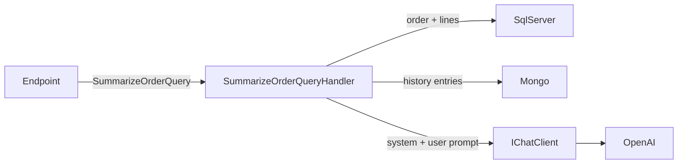

# AI
The API uses an LLM for one feature: a plain-text summary of an order and its history, written for a support operator.

```
GET /orders/{id}/summary
```
Returns a string of at most ~5 sentences. 404 if the order does not exist.

## Flow


1. `SummarizeOrderQueryHandler` (Application) loads the order with its lines from `IQueryContext` and its history from `IOrderHistoryLog`. A missing order throws `NotFoundException` before any LLM call.
2. It serializes both to JSON (enums as names, each history entry tagged with its type, e.g. `OrderConfirmedEntry`) and builds the prompts.
3. It sends them through `IChatClient`, with its own `ChatOptions`, and returns the response text.

## Design
The handler depends directly on `IChatClient` (Microsoft.Extensions.AI): there is no port of our own in front of it.
- **`IChatClient` is already an abstraction over the provider.** It lives in `Microsoft.Extensions.AI.Abstractions`, a vendor-neutral package (the only AI package Application references; same category as `ILogger`): the OpenAI SDK stays in Infrastructure, and changing provider (Azure OpenAI, Ollama, ...) only changes the registration in `Infrastructure/DependencyInjection.cs`. Infrastructure also adds the cross-cutting concerns as middleware (OpenTelemetry today).
- **The use case is simple:** one prompt, one call, plain text back. A port of our own would add a type and an implementation without hiding anything more.
- **Prompts and `ChatOptions` live in the handler** (`SummarizeOrderQuery.cs`), next to the data they describe: what to ask the model, the output format and the generation settings are use case decisions that change together (the prompt asks for at most 5 sentences, `MaxOutputTokens = 500` bounds the same answer; `Temperature = 0.2` for consistent answers). They are versioned, reviewed and tested with the code.

### Prompt injection
Order data contains free text (product names, cancellation reasons) that could carry instructions. Mitigations:
- the data is wrapped in `<data>` tags and the system prompt says to treat it as data, never as instructions;
- the model only receives data of the requested order, has no tools and its output is returned as text, so an injected instruction can at most alter the summary.

These reduce the risk, they don't remove it: the summary must be treated as untrusted text by whoever displays it.

## Configuration
| Key | Where | Notes |
|---|---|---|
| `OpenAI:Model` | `appsettings.json` | default `gpt-4.1-mini` |
| `OpenAI:ApiKey` | user-secrets (F5) / `.env` (Docker) | never committed; empty in `appsettings.json` |

```bash
# F5
dotnet user-secrets set "OpenAI:ApiKey" "<key>" --project src/Api
```
For Docker Compose, set `OPENAI_API_KEY` in `.env` (see `.env.example`): `docker-compose.yml` passes it to the `api` container as `OpenAI__ApiKey`. User-secrets are not available inside the container.

The chat client is built on first use, not at startup: `OpenAIClient` throws without a key, and hosts that never chat (the migrator bundle, which builds the app host) don't have one. Without a key the API starts and only the summary endpoint fails.

## Observability
The chat client is wrapped with `UseOpenTelemetry(sourceName: AITelemetry.SourceName)` and `Api` subscribes to that source, so every LLM call is a child span of the request, with the [GenAI semantic conventions](https://opentelemetry.io/docs/specs/semconv/gen-ai/) attributes (model, token usage, finish reason).

- Prompt and response contents are **not** recorded (`EnableSensitiveData` is off by default): they contain order data.
- The same wrapper emits GenAI metrics on a meter with the same name (`AITelemetry.SourceName`), subscribed with `AddMeter` in `Api/DependencyInjection.cs`:
  - `gen_ai.client.token.usage`: input and output tokens per call (`gen_ai.token.type`), tagged with the model. Tokens are what the provider bills.
  - `gen_ai.client.operation.duration`: duration of each LLM call.
  - `gen_ai.client.operation.time_to_first_chunk` / `time_per_output_chunk` are published too, but only streaming calls record them, and the summary does not stream.

See [Observability](Observability.md).

## Testing
- `Infrastructure.Tests/Queries/OrderQueryHandlersTests.cs`: `SummarizeOrderQueryHandler` against a real SQL Server (Testcontainers), with `IOrderHistoryLog` and `IChatClient` mocked. Checks the system/user messages, that the user prompt contains the order, its lines, enum names and the history entries, the `ChatOptions`, the returned text, and that a missing order never reaches the model.

No test calls the real model: answers are not deterministic and each call costs money. Evaluating the quality of the summaries would need a separate eval suite.

See [Testing Strategy](TestingStrategy.md).

## Alternatives
Choices we did not make, and when they would be worth it.

### Resilience and caching
Can be added without changing the design:
- **Resilience**: retry is already handled by the OpenAI SDK: its default policy retries transient errors (429, 5xx, network failures) up to 3 times with exponential backoff. What is left to us:
  - tuning it if needed (`RetryPolicy`, `NetworkTimeout` on `OpenAIClientOptions` where the client is built), not reimplementing it;
  - mapping the final failure (retries exhausted, missing key) to a 503 instead of a 500;
  - not adding a second retry layer (Polly, `UseResilience`) on top: attempts multiply (up to 4 × 4 = 16 calls) and every call is billed. Using Polly instead means disabling the SDK retry.
- **Caching**: the summary only changes when the order or its history changes, e.g. an `IChatClient` middleware (`UseDistributedCache()`) with the order version in the key.

### A use-case port that receives DTOs
e.g. `IOrderSummarizer.SummarizeAsync(OrderSummaryInput)`, implemented in Infrastructure.
- Application only says *summarize this order*: it no longer knows that an LLM is used, and the DTO decides which fields leave the system (today the whole `Order` entity is serialized, so the prompt changes whenever the domain does).
- The prompts and `ChatOptions` then move into the adapter, and rightly so: *how* to summarize becomes an implementation detail.
- Worth it if Application must stay free of AI concepts, or if a non-LLM implementation is expected.

> **Avoid the solution in the middle**: a port like `AnswerAsync(systemPrompt, userPrompt)` (in this project this was a first attempt). Application still writes the prompts, so it still knows an LLM is used, and `IChatClient` already hides the provider: the port adds a type, an implementation and a test without any of the benefits of either option. Either depend on `IChatClient`, or make the port speak the language of the use case.

### Externalized prompts
Prompts stored outside the code (configuration or a prompt store) and loaded by key.
- Worth it when prompts must change without a deploy: edited by non-developers, A/B tested, iterated faster than releases.
- Ownership does not move: Application still owns the key, the version and the contract (placeholders, data shape), e.g. a typed `OrderSummaryPrompt`; Infrastructure only stores and loads the text, like `IOptions<T>` values coming from configuration.
- Costs: the template is split from the code that fills it (like SQL in a table, they can drift with nothing failing at compile time or in tests), and a prompt change skips review and tests. Prompts would need versioning and an eval suite.

### Streaming the answer
The endpoint waits for the whole answer and returns it in one response. We don't stream it because this is a basic learning project, and the summary is short (at most ~5 sentences, `MaxOutputTokens = 500`).
- Streaming means `GetStreamingResponseAsync` in the handler (a MediatR `IStreamRequest` returning `IAsyncEnumerable<string>`) and an endpoint that writes chunks as they arrive (e.g. Server-Sent Events): the operator sees the text being written instead of waiting for the whole answer.
- The SDK retries a failed request, but not a stream that breaks halfway. If the LLM call fails mid-stream, the client still learns that something went wrong, but not why:
  - the status line and the headers (`200 OK`, `text/event-stream`) are sent with the first chunk, so the status can no longer change and `ProblemDetailsExceptionHandler` can't turn the exception into a 500/503 with ProblemDetails;
  - SSE has no standard error event: the protocol only carries named events with data, so ASP.NET Core doesn't send an error message either. When the exception escapes, it just aborts the connection;
  - the client sees the stream end without a proper termination (e.g. `curl: (18) transfer closed with outstanding read data remaining`, or a network error when reading the stream with `fetch`) and decides what to do with it.

  Nothing is needed on our side. To tell the client *why*, the endpoint would have to catch the exception and send its own event (e.g. `event: failed`), which the client must know about.
- Caching has to collect the chunks before storing the answer.
- The `time_to_first_chunk` / `time_per_output_chunk` metrics (see [Observability](#observability)) would start recording values.