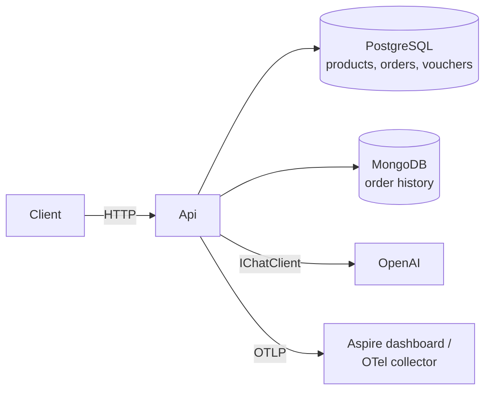
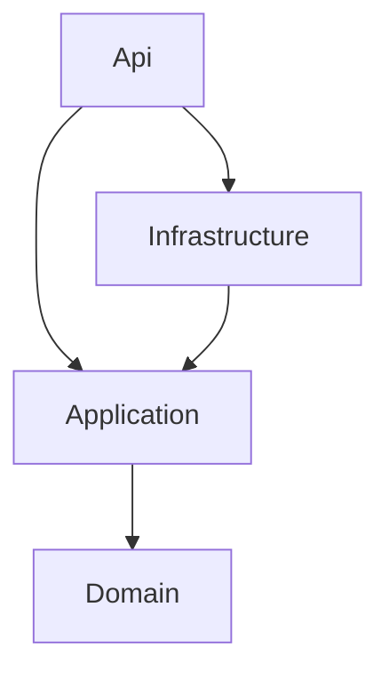
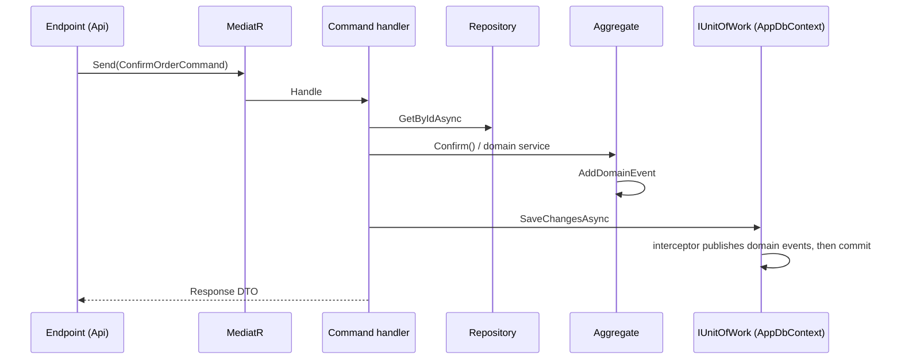

# Architecture

The map of the solution: what the parts are, how a request flows through them and where each decision is recorded. Deep dives live in the topic documents linked below; the reasons behind each choice live in the [ADRs](adr/README.md).

## Context

A single API that manages **products**, **orders** (draft, confirmed, shipped, canceled) and single-use **vouchers** applied at confirmation, and produces an LLM summary of an order for support operators. One consumer, no authentication, learning scope: several domain areas are deliberately simplified ([DomainSimplifications](DomainSimplifications.md)).

## Layers

Clean Architecture with four projects ([ADR-0001](adr/0001-clean-architecture.md), [CleanArchitecture](CleanArchitecture.md)).

| Project | Contains | Must not contain |
|---|---|---|
| `Domain` | Aggregates `Product`, `Order` (+ `OrderLine`), `Voucher`; `VoucherRedemptionService`; domain events; `DomainException` | EF, HTTP, persistence concerns |
| `Application` | Commands, queries and their handlers, event handlers, ports (`IOrderRepository`, `IUnitOfWork`, `IQueryContext`, `IOrderHistoryLog`), responses, `OrderMetrics` | Business rules, provider SDKs |
| `Infrastructure` | `AppDbContext`, Fluent API configurations, migrations, repositories, `DispatchDomainEventsInterceptor`, Mongo history log, OpenAI registration | Business rules |
| `Api` | Minimal API endpoints, `ProblemDetailsExceptionHandler`, OpenTelemetry and health checks setup, `.http` files | Use case logic |

Aggregates are rich: invariants are enforced inside their methods ([ADR-0002](adr/0002-rich-domain-model.md)).

## Request flow

### Command (write)

- Repositories behave like collections; the commit belongs to the unit of work, called explicitly by the handler ([ADR-0004](adr/0004-repositories-and-unit-of-work.md)).
- Domain events are published by an EF `SaveChanges` interceptor **before** the commit; their handlers write the order history to MongoDB ([ADR-0005](adr/0005-domain-events-before-commit.md), [DomainEventsHandling](DomainEventsHandling.md)).

### Query (read)

Query handlers read through `IQueryContext` (the `DbSet`s of `AppDbContext`) and project to response DTOs, skipping repositories because a read protects no invariant ([ADR-0003](adr/0003-cqrs-with-mediatr.md)).

### Errors

Endpoints contain no try/catch. Exceptions bubble up to `ProblemDetailsExceptionHandler`:

| Exception | Raised by | HTTP |
|---|---|---|
| `NotFoundException` | Handlers | 404 |
| `DomainException` | Aggregates | 400 |
| `ConflictException` | `AppDbContext.SaveChangesAsync` on a Postgres unique violation (concurrent voucher redemption) | 409 |
| `BadHttpRequestException` | Minimal API binding (missing required parameter, malformed JSON body) | its own status, usually 400 |
| anything else | | 500 with `traceId` |

## Persistence

- **PostgreSQL** (EF Core, Npgsql, snake_case names) is the source of truth for the three aggregates ([ADR-0006](adr/0006-postgresql-and-mongodb.md), [EFCore](EFCore.md)).
- **MongoDB** stores the order history entries (polymorphic documents), written by domain event handlers. It is not in the EF transaction: a rolled-back save can leave orphan history entries, accepted for a learning scope.
- **Migrations** are applied by a separate `migrator` container (EF migrations bundle) before the API starts, never at API startup ([ADR-0009](adr/0009-migrations-with-migrator-container.md)). Mongo indexes are created idempotently at startup.

## AI

`GET /orders/{id}/summary`: `SummarizeOrderQueryHandler` loads the order and its history and calls `IChatClient` directly, with prompts and `ChatOptions` in the handler. The OpenAI SDK is registered only in Infrastructure ([ADR-0007](adr/0007-ichatclient-without-own-port.md), [AI](AI.md)).

## Observability

OpenTelemetry for traces, metrics and logs, exported over OTLP when `OTEL_EXPORTER_OTLP_ENDPOINT` is set (Aspire dashboard in development). Custom meter `ProductApi.Orders`; GenAI spans and token metrics without prompt contents. Health checks: `/alive` (liveness) and `/health` (database and MongoDB), mapped only in Development ([Observability](Observability.md)).

## Testing

| Project | Scope | Dependencies |
|---|---|---|
| `Domain.Tests` | Aggregates and domain services | None |
| `Application.Tests` | Command and event handlers | Moq |
| `Infrastructure.Tests` | Repositories, interceptor, **query handlers** | Postgres via Testcontainers, one database per test cloned from a migrated template |

See [ADR-0008](adr/0008-integration-tests-with-testcontainers.md) and [TestingStrategy](TestingStrategy.md).

## Runtime and delivery

- Local: `docker compose up -d` for the infrastructure, `--profile app` to also run the containerized API.
- CI/CD is designed but not implemented ([CICD](CICD.md)).

## Known limits

- Domain event handlers run inside the request and before the commit: added latency, possible Mongo orphans, no outbox.
- Every unique violation is translated to a voucher conflict: correct only while the voucher index is the only unique index.
- Health endpoints are mapped only in Development: production probes need them, after a review of what they expose.
- The summary endpoint returns 500 when the LLM call fails (no 503 mapping yet).
- No authentication or authorization.

## Decision records

| ADR | Decision |
|---|---|
| [0001](adr/0001-clean-architecture.md) | Clean Architecture with four projects |
| [0002](adr/0002-rich-domain-model.md) | Rich domain model with aggregates that enforce invariants |
| [0003](adr/0003-cqrs-with-mediatr.md) | CQRS with MediatR, queries bypass repositories |
| [0004](adr/0004-repositories-and-unit-of-work.md) | Collection-like repositories, `DbContext` as unit of work, explicit commit |
| [0005](adr/0005-domain-events-before-commit.md) | Domain events dispatched before the commit by an EF interceptor, no outbox |
| [0006](adr/0006-postgresql-and-mongodb.md) | PostgreSQL for aggregates, MongoDB for order history |
| [0007](adr/0007-ichatclient-without-own-port.md) | `IChatClient` used directly, no port of our own |
| [0008](adr/0008-integration-tests-with-testcontainers.md) | Integration tests on real Postgres with Testcontainers |
| [0009](adr/0009-migrations-with-migrator-container.md) | Migrations applied by a dedicated migrator container |
| [0010](adr/0010-migrations-editable-until-pushed.md) | Migrations editable until pushed, forward-only after |
| [0011](adr/0011-github-flow.md) | GitHub Flow with a protected `main` |
| [0012](adr/0012-squash-merge-only.md) | Squash merge only |
