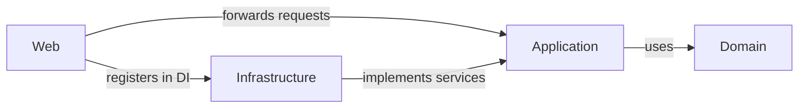

This doc is for the Jason Taylor's Template on Clean Architecture. 

See: [link](https://cleanarchitecture.jasontaylor.dev/docs/getting-started/first-project/)

- ___Web___:
    - Assembles the application with the web application builder (wiring and DI; reference to Infrastructure for DI)
    - Exposes the HTTP endpoints and handles their routing (IEndpointGroup + MapEndpoints)
    - It just:
        - Contains the global exception handler, which maps exceptions to HTTP status codes and details
        - Contains the OpenAPI transformers (documentation only)
        - Contains the authentication endpoints
        - Implements `IUser` (defined in Application) using `IHttpContextAccessor` to return the user id and roles, and registers it in DI
    - Only forwards requests to Application: 
        - the only validation is coherence on update between value of id specified in the url and in the body
        - authorization, logging and performance are behaviors in Application, not here
- ___Application___:
    - Coordinates use case logic
        - Sequence of steps
        - Data loading
        - Commit
        - `if`s, but only about
            - Data coming in from the requests (is there a voucher?)
            - Loading outcomes (does the product exist?)
            - Path choices (confirm with or without a voucher?)
            - NO business rules that must always hold (an expired voucher can't be redeemed), because those must live in the Domain
    - Defines the interfaces it needs to talk to the outside world
    - Defines commands, queries, responses, application exceptions
    - Hosts the MediatR pipeline behaviors (validation, authorization, logging, performance)
- ___Infrastructure___:
    - Implements the interfaces Application needs to talk to the outside world (persistence, clients to external systems, file system, clock)
    - Exception: `IUser` is implemented in Web, not here, because it needs `HttpContext`
- ___Domain___:
    - Contains the entities with the invariants to protect, i.e. the enterprise domain rules that must always be valid.
    - Contains the value objects
    - Contains the domain services that coordinate cross-aggregate business rules
        - They contain a rule that must always be true! (e.g. confirming an order with a voucher must redeem the voucher and subtract the amount from the order in a single step; if this weren't done in a domain service, this logic would end up in Application and you could forget an operation)
        - They receive already-loaded domain objects
        - They do NOT touch the DB or the network

- Jason Taylor's Clean Architecture solution also contains other peripheral csproj files that hold the scaffolding to run and instrument the application through Aspire or to test it:
    - ___Shared___: Contains the names of the various services (webapi, dbserver, ...) used in AppHost and in Infrastructure. This project risks filling up with helpers that shouldn't exist.
    - ___AppHost___:
        - Contains a host that acts as an orchestrator in the development environment: a sort of docker compose that describes all the components of the application (api and db), starts them, does service discovery (lets FE, BE and DB talk to each other without having to hardcode URLs) and also starts the Aspire developer dashboard to monitor the application.
        - This host does not end up in PRD, but the builder contains `builder.AddAzureContainerAppEnvironment("aca-env")`, which declares the deployment target (Azure Container Apps) used when you run `aspire publish` / `aspire deploy`.
    - ___ServiceDefaults___: Contains a builder extension method that adds Aspire's default services (OpenTelemetry, health checks, service discovery, HttpClient configuration).
        - The idea is that if there are several independent API projects under the solution, they don't have to rewrite all of Aspire's base Add calls every time.
    - ___Tests___: contains the tests (unit, integration, functional, ...)

----
___Peripheral stuff___:
- AddOpenAPI instead of Swashbuckle
- Scalar instead of SwaggerUI
- Global exception handler that sets the status code according to the exception and puts the details in the body, which differ depending on the exception
- An IEndpointGroup, a MapEndpoints extension method and MapGet/MapPut extension methods to handle routing...
    - MapEndpoints scans all the classes that implement IEndpointGroup, sets the group and the route prefix and then invokes the class's Map method so that they get mapped (basically it does in minimal API what controllers used to do for free).

___What I don't like___:
- Web/Infrastructure mixes things used for the OpenAPI documentation (transformers), things the API needs at runtime (exception handler), and things used to build the app (MapEndpoints and interfaces)
- Domain is dumb, doesn't protect invariants, doesn't show cross-aggregate operations

___Differences___:
- Endpoints:
    - In the create endpoints it returns only the id
    - In the update endpoints it passes the id both in the body and in the segment, instead of using a separate request, and then it checks them and returns BadRequest if they differ
    - In the endpoints it uses MediatR's ISender instead of IMediator
- Commands:
    - Validation is done through classes like "CreateTodoItemCommandValidator", which use FluentValidation inside
    - Validation is run by a behavior that checks whether there is a validator for the command, runs all the validations and, if there are errors, throws a ValidationException containing a dictionary of errors
    - Authorization / Logging / Performance are handled through behaviors
- Queries:
    - For Entity > DTO it uses AutoMapper
    - It's better than mapping in memory because the projection is done DB-side, turning the AutoMapper configuration into a LINQ expression that EF converts to SQL
        - An explicit `Select` gives the same SQL without the dependency
        - AutoMapper is now under a dual commercial license
- Domain:
    - Being an example, it doesn't protect the entities' state but makes it accessible to everyone
        - The only exception is the setter of `Done`, which raises a domain event

___Other points___:
- Validation (two different things, not to be mixed):
    - Command validation: checks that the request is well-formed (empty fields, lengths, formats). It looks only at the command, so it can run before the handler and report all errors at once.
        - Template: `FluentValidation` validators (e.g. `CreateTodoItemCommandValidator`), run by a behavior that throws a `ValidationException` with a dictionary of errors.
        - Mine: none yet.
    - Domain invariants: rules that must always hold for the entity, whichever code path changes it (a command, a batch, a test).
        - Template: almost none, since the entities expose their state. It is not clear from the template whether the validators are also meant to cover invariants; I assume not.
        - Mine: they live in the entities (factory methods and behavior methods) and throw a `DomainException` on the first violated rule.
    - Quick test to tell them apart: if a second entry point skipped the validator, would the rule still hold? If yes, it is an invariant; if not, it was only a filter on the input.
    - Overlap: some rules show up in both (e.g. a name's max length). The shared constant should live in the Domain and the validator should read it, so there is only one source of truth.
- Where to save: in the command handlers
- Does it use a repository? NO (mine does, for commands): handlers use an interface over the `DbContext` defined in Application, so Application references EF Core
- Domain events: raised by the entity (e.g. `TodoItemCompleted` when `Done` becomes true) and published by a `SaveChanges` interceptor in Infrastructure before `SaveChanges`, so handlers run in the same transaction; the only handler seen just logs
- Aggregates: `TodoList` and `TodoItem` are two independent aggregates; `CreateTodoItem` does not check that the list exists, and no foreign key exists on the item's list id