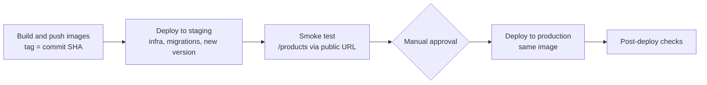

# CI/CD
 
> **Status: CI running on every pull request; CD written, not yet run** (off until the repository variable `CD_ENABLED` is `true`). Workflows in `.github/workflows/` (`ci.yml`, `cd.yml` with `deploy.yml`, `teardown.yml`), Bicep in `infra/`. Setup and maintenance of CI and CD: [MAINTAINING](../MAINTAINING.md).
> This document records how I would build, test and deploy the project, and why.
 
## Principles
 
- **Build once, promote the same image.** The image tested in staging is the image that reaches production; it is never rebuilt.
- **Immutable tags.** Images are tagged with the commit SHA. `latest` is never used for a deployment.
- **The same checks locally and in CI,** so that what passes on my machine passes in the pipeline.
- **Least privilege, no stored secrets.** The pipeline authenticates to the cloud with short-lived federated credentials.
- **Migrations are forward-only once merged** ([ADR-0009](adr/0009-migrations-forward-only-after-merge.md)).

## 1. Feedback before pushing
 
A push to a feature branch is never rejected: the checks run afterwards and block the **merge**, not the push. Fixing a failed check means one more commit on the same branch and the same pull request (squash merge keeps the history clean). Local checks only make that feedback faster.
 
- **Format on save** with the C# Dev Kit formatter, driven by `.editorconfig`.
- **Optional git hooks** with [Husky.Net](https://github.com/alirezanet/Husky.Net), not set up yet:
  - `pre-commit`: `dotnet format --verify-no-changes` (fast, aborts the commit if something needs formatting).
  - `pre-push`: unit tests, if they stay fast.
  - Integration tests (they need Docker) run only in CI: a slow hook ends up being skipped.
- **Hooks are a convenience, not a barrier:** they can be skipped with `--no-verify` and every clone has to install them. The real gate is the CI with required checks.
- **One-time cleanup:** `dotnet format` on the whole solution in a **separate commit**, whose hash goes into `.git-blame-ignore-revs`. Check line endings (`.editorconfig`, `.gitattributes`) before running it, or every file will be rewritten.

## 2. Pull request pipeline (CI)
 
Two rulesets on `main` ([CONTRIBUTING](../CONTRIBUTING.md)), whose rules add up:

- `main-require-pr`: no direct pushes, no force pushes, no deletion, no bypass, squash merge only ([CONTRIBUTING](../CONTRIBUTING.md#squash-merge-only)). Required approvals: 0, because GitHub does not let authors approve their own pull requests and the project has a single maintainer.
- `main-quality-gates`: required status checks green, CodeQL results without high or critical alerts.

They are versioned in `.github/rulesets/` and applied with `.github/rulesets/sync.sh`; the repository settings a ruleset cannot express (merge buttons, Dependabot alerts, secret scanning, CodeQL) are set by hand in the UI. Both, and in which order: [CI setup and maintenance](administrators/CISetupAndMaintenance.md).
 
### Gates

Every pull request to `main` goes through these gates. **Blocking** gates stop the merge (required checks or ruleset rules); **informational** ones report without blocking.

| Gate | Tool | Where | Blocks |
|---|---|---|---|
| Format | `dotnet format --verify-no-changes` | `ci.yml` / `build-and-test` | Yes |
| Build, warnings as errors | `dotnet build -warnaserror` | `build-and-test` | Yes |
| Code style in the build | `EnforceCodeStyleInBuild` (`Directory.Build.props`) and `.editorconfig`; today IDE0005, unnecessary `using`. IDE0005 runs in the build only with `GenerateDocumentationFile` (CS1591, missing XML comments, is suppressed; in `Api` also CS1573, because endpoint methods document only the request parameters). Migrations are generated code and excluded | `build-and-test` | Yes |
| Unit tests | `Domain.Tests`, `Application.Tests` | `build-and-test` | Yes |
| Integration tests | `Infrastructure.Tests` on SQL Server via Testcontainers (Docker on the runner) | `build-and-test` | Yes |
| Vulnerable packages, transitive included | NuGet audit during `dotnet restore` (NU1901-NU1904, any severity from low); the warnings are replayed by `dotnet build -warnaserror`, which fails. If the vulnerability source is unreachable, NU1900 fails the build too | `build-and-test` | Yes |
| Shared migrations untouched, no forgotten migration | `git diff` on `src/Infrastructure/Migrations/`, `dotnet ef migrations has-pending-model-changes` ([ADR-0009](adr/0009-migrations-forward-only-after-merge.md)) | `build-and-test` | Yes |
| Images build | `docker build` of the API and migrator targets, not pushed | `images` | Yes |
| Image vulnerabilities | Trivy on both images: **critical** vulnerabilities **with a fix** (`ignore-unfixed`); "high" on base images would be mostly noise | `images` | Yes |
| New dependencies | Dependency Review: a pull request that adds a dependency with a **high or critical** vulnerability | `dependency-review` | Yes |
| Bicep | `az bicep lint` (rules in `infra/bicepconfig.json`) and `az bicep build` | `bicep` | Yes |
| Code security (SAST) | CodeQL, GitHub default setup, on C# and the GitHub Actions workflows; the ruleset rule blocks **high or critical** security alerts and CodeQL errors | GitHub (not in `ci.yml`) | Yes |
| Secrets | Secret scanning with **push protection**: a push containing a known secret format is rejected | GitHub repository setting | Yes, at push time |
| Infrastructure best practices | PSRule for Azure (Well-Architected rules) on the Bicep, configured in `ps-rule.yaml`; some findings are accepted trade-offs ([ADR-0011](adr/0011-azure-infrastructure.md)) | `psrule` | No |
| Dependency updates | Dependabot version updates: weekly pull requests for NuGet, GitHub Actions, Dockerfile and Docker Compose, vulnerable or not (`.github/dependabot.yml`) | GitHub | No |
| Vulnerable dependencies fixes | Dependabot alerts and security updates: a pull request as soon as a vulnerability affects a dependency, without waiting for the weekly run (repository setting) | GitHub | No |

Required status checks: `build-and-test`, `images`, `bicep`, `dependency-review`. Branches do not need to be up to date with `main` before merging (one maintainer, small pull requests).

Actions in every workflow are pinned to a commit SHA, with the version in a comment: a tag can be moved to another commit, a SHA cannot (GitHub security hardening guide). Dependabot updates the SHA and the comment. The pin covers the action's code, not what it downloads at run time (the Trivy binary, the PSRule modules).

Not adopted: a code coverage threshold (it rewards writing tests for the number), third-party analyzers (SonarAnalyzer, Roslynator).

## 3. Deployment pipeline (CD)
 
Triggered by a merge on `main`.
 

 
- **Registry:** GitHub Container Registry (`ghcr.io/mgiuseppe/productapi-api`, `-migrator`), public packages, so Container Apps pull without credentials; Azure Container Registry would cost about 5 USD a month.
- **Order in each environment** (`deploy.yml`): the stack is deployed with the API image already running and the new migrator image; the migrator job runs and must succeed; only then the API gets the new image; a smoke test calls the public URL.
- **Staging first,** then a manual approval, then production with the **same image** and the same steps.
- **Rollback** means redeploying the previous image tag. The database is not rolled back (see Migrations).
- **Status:** the pipeline has run end to end on staging (infrastructure, database users, migrations, API, smoke test, telemetry). Production has never been deployed: the free trial subscription allows one Container Apps environment per region (`MaxNumberOfRegionalEnvironmentsInSubExceeded`), and staging uses it. The production steps are the same as staging's, so they are expected to work on a subscription without that quota. The environments are ephemeral: they are torn down after each verification and CD is off (`CD_ENABLED=false`) in between.

## 4. Environments, identity and secrets
 
- **GitHub Environments** (`staging`, `production`) with required reviewers for production.
- **OIDC federated credentials** instead of stored secrets: Microsoft recommends OpenID Connect for GitHub Actions because no persistent credential can leak. One identity **per environment**, with minimal RBAC, so a staging run can never touch production.
  References: [Bicep CI/CD Handbook](https://azure.github.io/bicep-cicd-handbook/setup/oidc), [Deploy to Azure with GitHub Actions](https://learn.microsoft.com/devops/deliver/iac-github-actions).
- **Secrets:** Azure SQL has no password: the API and the migrator sign in with their own user-assigned identity, and the deploy workflow creates their database users with `azure/sql-action` ([ADR-0012](adr/0012-identities-and-secrets.md)). The MongoDB password is a GitHub secret passed to Bicep, which writes the connection string into the Key Vault of the environment, read by both identities ([ADR-0012](adr/0012-identities-and-secrets.md)). `ALERT_EMAIL` is a secret too, not because it is a credential, but so that it is masked in the workflow logs, public in a public repository.
- **Configuration:** `appsettings.json` holds non-secret defaults; environment variables override them (`ConnectionStrings__DbConnection`, ...). Secrets come from a secret store (for example Key Vault) through managed identities, never from files in the repository.
- **Telemetry:** on Azure the API exports to the Application Insights of its environment with the Azure Monitor OpenTelemetry distro; the Container Apps environment sends console and system logs to the same Log Analytics workspace ([ADR-0013](adr/0013-application-insights.md)). The Aspire dashboard used in `docker-compose.yml` is a development tool only.

## 5. Infrastructure
 
- **Local:** Docker Compose (`docker compose up -d` for the infrastructure, `--profile app` for everything). Compose is not used in production.
- **Target:** Azure Container Apps (consumption), with **managed** Azure SQL (serverless) and Azure DocumentDB (MongoDB compatible) instead of containers ([ADR-0011](adr/0011-azure-infrastructure.md)).
- **Infrastructure as code:** Bicep in `infra/`, deployed as one **deployment stack** per environment with the same settings everywhere ([ADR-0011](adr/0011-azure-infrastructure.md)):
  - `infra/main.bicep` at subscription scope creates the resource group and calls the modules in `infra/modules/`; `infra/<environment>.bicepparam` holds what differs between environments.
  - Deploy: `az stack sub create --action-on-unmanage detachAll --deny-settings-mode denyDelete`. A deployment never deletes resources, and resources of the stack cannot be deleted by hand.
  - Teardown: `az stack sub delete --action-on-unmanage deleteAll`, a separate manual operation and the only one that deletes resources.
  - A third stack, `productapi-shared`, owns the free DocumentDB cluster used by both environments, one database each. The pipeline deploys it on every run before the environments (idempotent); only "tear down everything" deletes it ([ADR-0011](adr/0011-azure-infrastructure.md)). Everything runs in France Central ([ADR-0011](adr/0011-azure-infrastructure.md)).
  - The pull request builds and lints the `.bicep` files (`infra/bicepconfig.json`) and checks them with PSRule; it does not preview the changes (see Not covered). The `.bicepparam` files read pipeline values with `readEnvironmentVariable` and compile only inside a GitHub environment that provides them.

## 6. Database migrations
 
- The **migrator** image (an EF Core migrations bundle) runs **before** the new application version and exits. The API never applies migrations on startup.
- Forward-only once on `main`: a mistake is fixed with a new migration. No expand/contract: a breaking change goes out in one release with a short downtime ([ADR-0009](adr/0009-migrations-forward-only-after-merge.md)).
- MongoDB indexes are created by the application at startup, idempotently; there is no init script.
- Production deployments should treat a failing migrator as a stop: the application is not updated.

## 7. Health and rollout
 
- `/alive` is the liveness check (the process is up) and `/health` the full one (database included). The platform probes use them.
- The health endpoints answer only on a dedicated port (8081), in every environment: the probes target that port, the public ingress exposes only 8080 ([Observability](Observability.md#health-checks)). The probe interval matters: while a replica runs, every readiness probe queries the serverless SQL database and keeps it awake.
- Rollout: each deployment creates a new Container Apps revision (single revision mode), which receives the traffic once its probes pass. Rollback redeploys the previous image tag.
- The probes act on their own (restart, no traffic) but notify nobody: an email alert covers what they cannot fix ([Observability](Observability.md#alerts)).

## Not covered
 
- A `what-if` preview of the Bicep changes on pull requests (it needs an Azure sign-in from pull requests).
- Logs and traces in Azure: the Container Apps environment has no log destination yet.
- Cloud costs, backups and retention of the managed databases.
- SBOM (an inventory of the components in the image) and image signing (to verify that an image comes from the pipeline and was not altered).
- Trace sampling.
