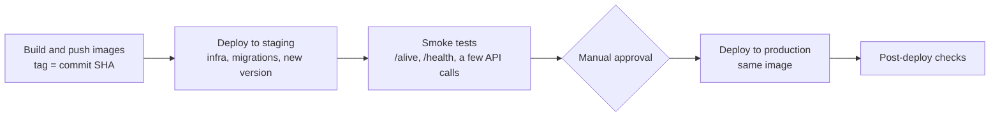

Cicd · MD
# CI/CD
 
> **Status: written, not yet run.** Workflows in `.github/workflows/` (`ci.yml`, `cd.yml` with `deploy.yml`, `teardown.yml`), Bicep in `infra/`. The one-time setup is in [SETUP_CICD_ONETIME.md](../SETUP_CICD_ONETIME.md).
> This document records how I would build, test and deploy the project, and why.
 
## Principles
 
- **Build once, promote the same image.** The image tested in staging is the image that reaches production; it is never rebuilt.
- **Immutable tags.** Images are tagged with the commit SHA. `latest` is never used for a deployment.
- **The same checks locally and in CI,** so that what passes on my machine passes in the pipeline.
- **Least privilege, no stored secrets.** The pipeline authenticates to the cloud with short-lived federated credentials.
- **Migrations are forward-only once merged** ([ADR-0010](adr/0010-migrations-editable-until-pushed.md)).

## 1. Feedback before pushing
 
A push to a feature branch is never rejected: the checks run afterwards and block the **merge**, not the push. Fixing a failed check means one more commit on the same branch and the same pull request (squash merge keeps the history clean). Local checks only make that feedback faster.
 
- **Format on save** with the C# Dev Kit formatter, driven by `.editorconfig`.
- **Optional git hooks** with [Husky.Net](https://github.com/alirezanet/Husky.Net):
  - `pre-commit`: `dotnet format --verify-no-changes` (fast, aborts the commit if something needs formatting).
  - `pre-push`: unit tests, if they stay fast.
  - Integration tests (they need Docker) run only in CI: a slow hook ends up being skipped.
- **Hooks are a convenience, not a barrier:** they can be skipped with `--no-verify` and every clone has to install them. The real gate is the CI with required checks.
- **One-time cleanup:** `dotnet format` on the whole solution in a **separate commit**, whose hash goes into `.git-blame-ignore-revs`. Check line endings (`.editorconfig`, `.gitattributes`) before running it, or every file will be rewritten.

## 2. Pull request pipeline (CI)
 
Ruleset on `main` ([CONTRIBUTING](../CONTRIBUTING.md)): no direct pushes, no force pushes, no bypass, required checks green, squash merge only ([CONTRIBUTING](../CONTRIBUTING.md#squash-merge-only)). Required approvals: 0, because GitHub does not let authors approve their own pull requests and the project has a single maintainer.

The ruleset is versioned in `.github/rulesets/main.json`; how to apply it is in [SETUP_CICD_ONETIME.md](../SETUP_CICD_ONETIME.md).
 
| # | Check | Notes |
|---|---|---|
| 1 | Restore and build | Warnings treated as errors, except where a known false positive is documented |
| 2 | Format check | `dotnet format --verify-no-changes` |
| 3 | Unit tests | `Domain.Tests`, `Application.Tests` |
| 4 | Integration tests | `Infrastructure.Tests`: they start a SQL Server container, so the runner needs a Docker daemon (GitHub-hosted Ubuntu runners should have one) |
| 5 | Dependency vulnerabilities | NuGet audit (NU1902 and similar); `dotnet list package --vulnerable` |
| 6 | Image build | `docker build` for the API image (`--target final`) and the migrator image (`--target migrator`), without pushing |
 
## 3. Deployment pipeline (CD)
 
Triggered by a merge on `main`.
 

 
- **Registry:** GitHub Container Registry (`ghcr.io/mgiuseppe/productapi-api`, `-migrator`), public packages, so Container Apps pull without credentials; Azure Container Registry would cost about 5 USD a month.
- **Order in each environment** (`deploy.yml`): the stack is deployed with the API image already running and the new migrator image; the migrator job runs and must succeed; only then the API gets the new image; a smoke test calls the public URL.
- **Staging first,** then a manual approval, then production with the **same image** and the same steps.
- **Rollback** means redeploying the previous image tag. The database is not rolled back (see Migrations).

## 4. Environments, identity and secrets
 
- **GitHub Environments** (`staging`, `production`) with required reviewers for production.
- **OIDC federated credentials** instead of stored secrets: Microsoft recommends OpenID Connect for GitHub Actions because no persistent credential can leak. One identity **per environment**, with minimal RBAC, so a staging run can never touch production.
  References: [Bicep CI/CD Handbook](https://azure.github.io/bicep-cicd-handbook/setup/oidc), [Deploy to Azure with GitHub Actions](https://learn.microsoft.com/devops/deliver/iac-github-actions).
- **Secrets:** the SQL and MongoDB passwords are GitHub secrets passed to Bicep; Bicep writes the connection strings into the Key Vault of the environment, and the Container App and the migrator job read them through a user-assigned identity of the environment ([ADR-0015](adr/0015-azure-infrastructure.md)).
- **Configuration:** `appsettings.json` holds non-secret defaults; environment variables override them (`ConnectionStrings__DbConnection`, ...). Secrets come from a secret store (for example Key Vault) through managed identities, never from files in the repository.
- **Telemetry:** OpenTelemetry exports to Azure Monitor / Application Insights in production. The Aspire dashboard used in `docker-compose.yml` is a development tool only.

## 5. Infrastructure
 
- **Local:** Docker Compose (`docker compose up -d` for the infrastructure, `--profile app` for everything). Compose is not used in production.
- **Target:** Azure Container Apps / App Service / AKS, with **managed** Azure SQL and MongoDB-compatible services instead of containers.
- **Infrastructure as code:** Bicep in `infra/`, deployed as one **deployment stack** per environment with the same settings everywhere ([ADR-0015](adr/0015-azure-infrastructure.md)):
  - `infra/main.bicep` at subscription scope creates the resource group and calls the modules in `infra/modules/`; `infra/<environment>.bicepparam` holds what differs between environments.
  - Deploy: `az stack sub create --action-on-unmanage detachAll --deny-settings-mode denyDelete`. A deployment never deletes resources, and resources of the stack cannot be deleted by hand.
  - Teardown: `az stack sub delete --action-on-unmanage deleteAll`, a separate manual operation and the only one that deletes resources.
  - A third stack, `productapi-shared`, owns the free DocumentDB cluster used by both environments, one database each. The pipeline deploys it on every run before the environments (idempotent); only "tear down everything" deletes it ([ADR-0015](adr/0015-azure-infrastructure.md)). Everything runs in North Europe.
  - The pull request builds and lints the `.bicep` files (`infra/bicepconfig.json`) and shows a preview of the changes before approval. The `.bicepparam` files read pipeline values with `readEnvironmentVariable` and compile only inside a GitHub environment that provides them.

## 6. Database migrations
 
- The **migrator** image (an EF Core migrations bundle) runs **before** the new application version and exits. The API never applies migrations on startup.
- Forward-only once on `main`: a mistake is fixed with a new migration. No expand/contract: a breaking change goes out in one release with a short downtime ([ADR-0010](adr/0010-migrations-editable-until-pushed.md)).
- MongoDB indexes are created by the application at startup, idempotently; there is no init script.
- Production deployments should treat a failing migrator as a stop: the application is not updated.

## 7. Health and rollout
 
- `/alive` is the liveness check (the process is up) and `/health` the full one (database included). The platform probes use them.
- The health endpoints answer only on a dedicated port (8081), in every environment: the probes target that port, the public ingress exposes only 8080 ([Observability](Observability.md#health-checks)). The probe interval matters: while a replica runs, every readiness probe queries the serverless SQL database and keeps it awake.
- Rollout creates a new revision of the application and shifts traffic to it; rollback shifts it back or redeploys the previous tag, the exact mechanism is up to the chosen platform.

## Not covered
 
- A `what-if` preview of the Bicep changes on pull requests (it needs an Azure sign-in from pull requests).
- Logs and traces in Azure: the Container Apps environment has no log destination yet.
- Cloud costs, backups and retention of the managed databases.
- Image vulnerability scanning, SBOM (an inventory of the components in the image) and signing (to verify that an image comes from the pipeline and was not altered).
- Trace sampling and alerting.
