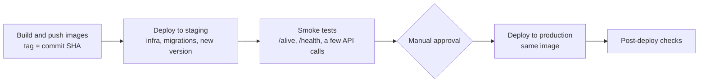

Cicd · MD
# CI/CD
 
> **Status: design only, not implemented.** This repository has no pipeline yet.
> This document records how I would build, test and deploy the project, and why.
 
## Principles
 
- **Build once, promote the same image.** The image tested in staging is the image that reaches production; it is never rebuilt.
- **Immutable tags.** Images are tagged with the commit SHA. `latest` is never used for a deployment.
- **The same checks locally and in CI,** so that what passes on my machine passes in the pipeline.
- **Least privilege, no stored secrets.** The pipeline authenticates to the cloud with short-lived federated credentials.
- **Migrations should be forward-only and backward compatible.**

## 1. Feedback before pushing
 
A push to a feature branch is never rejected: the checks run afterwards and block the **merge**, not the push. Fixing a failed check means one more commit on the same branch and the same pull request (squash merge keeps the history clean). Local checks only make that feedback faster.
 
- **Format on save** with the C# Dev Kit formatter, driven by `.editorconfig`.
- **Optional git hooks** with [Husky.Net](https://github.com/alirezanet/Husky.Net):
  - `pre-commit`: `dotnet format --verify-no-changes` (fast, aborts the commit if something needs formatting).
  - `pre-push`: unit tests, if they stay fast.
  - Integration tests (they need Docker) run only in CI: a slow hook ends up being skipped.
- **Hooks are a convenience, not a barrier:** they can be skipped with `--no-verify` and every clone has to install them. The real gate is the CI with required checks.
- **One-time cleanup:** `dotnet format` on the whole solution in a **separate commit**, whose hash goes into `.git-blame-ignore-revs`. Check line endings (`.editorconfig`, `.gitattributes`) before running it, or every file will be rewritten.

## 2. Pull request pipeline (CI)
 
Branch protection on `main`: no direct pushes, at least one review, required checks green, squash merge.
 
| # | Check | Notes |
|---|---|---|
| 1 | Restore and build | Warnings treated as errors, except where a known false positive is documented |
| 2 | Format check | `dotnet format --verify-no-changes` |
| 3 | Unit tests | `Domain.Tests`, `Application.Tests` |
| 4 | Integration tests | `Infrastructure.Tests`: they start a PostgreSQL container, so the runner needs a Docker daemon (GitHub-hosted Ubuntu runners should have one) |
| 5 | Dependency vulnerabilities | NuGet audit (NU1902 and similar); `dotnet list package --vulnerable` |
| 6 | Image build | `docker build` for the API image (`--target final`) and the migrator image (`--target migrator`), without pushing |
 
## 3. Deployment pipeline (CD)
 
Triggered by a merge on `main`.
 

 
- **Registry:** Azure Container Registry (or GitHub Container Registry). On Azure Container Apps the images must be in a registry before they can run.
- **Staging first,** then a manual approval, then production with the **same image** and the same steps.
- **Rollback** means redeploying the previous image tag. The database is not rolled back (see Migrations).

## 4. Environments, identity and secrets
 
- **GitHub Environments** (`staging`, `production`) with required reviewers for production.
- **OIDC federated credentials** instead of stored secrets: Microsoft recommends OpenID Connect for GitHub Actions because no persistent credential can leak. One identity **per environment**, with minimal RBAC, so a staging run can never touch production.
  References: [Bicep CI/CD Handbook](https://azure.github.io/bicep-cicd-handbook/setup/oidc), [Deploy to Azure with GitHub Actions](https://learn.microsoft.com/devops/deliver/iac-github-actions).
- **Configuration:** `appsettings.json` holds non-secret defaults; environment variables override them (`ConnectionStrings__DbConnection`, ...). Secrets come from a secret store (for example Key Vault) through managed identities, never from files in the repository.
- **Telemetry:** OpenTelemetry exports to Azure Monitor / Application Insights in production. The Aspire dashboard used in `compose.yml` is a development tool only.

## 5. Infrastructure
 
- **Local:** Docker Compose (`docker compose up -d` for the infrastructure, `--profile app` for everything). Compose is not used in production.
- **Target:** Azure Container Apps / App Service / AKS, with **managed** PostgreSQL and MongoDB-compatible services instead of containers.
- **Infrastructure as code:** Bicep. The pull request runs `bicep build` on modified .bicep files and a what-if is shown in the PR before approval (a preview of what will be changed). The reviewer can approve the PR (the PRD environment approval is in CD paragraph) and then deployment runs (You can also use a different repo for the bicep files).

## 6. Database migrations
 
- The **migrator** image (an EF Core migrations bundle) runs **before** the new application version and exits. The API never applies migrations on startup.
- During a rolling update the old and the new version run side by side on the same schema, so every migration must be **backward compatible**: add in one release, remove in a later one (expand/contract). Forward-only: a mistake is fixed with a new migration.
- MongoDB indexes are created by the application at startup, idempotently; there is no init script.
- Production deployments should treat a failing migrator as a stop: the application is not updated.

## 7. Health and rollout
 
- `/alive` is the liveness check (the process is up) and `/health` the full one (database included). The platform probes use them.
- Today the health endpoints are mapped only in `Development`. If production probes rely on them, they must be mapped in production too, after reviewing what they expose.
- Rollout creates a new revision of the application and shifts traffic to it; rollback shifts it back or redeploys the previous tag, the exact mechanism is up to the chosen platform.

## Not covered
 
- Pipeline files (`.github/workflows/*.yml`) and Bicep templates: not written.
- Cloud costs, backups and retention of the managed databases.
- Image vulnerability scanning, SBOM (an inventory of the components in the image) and signing (to verify that an image comes from the pipeline and was not altered).
- Trace sampling and alerting.

## Why it is not implemented

This is a learning project, so the pipeline itself is out of scope. If I had to implement it, the first step would be a `ci.yml` GitHub Actions workflow for pull requests. The deployment stages depend on the target platform..