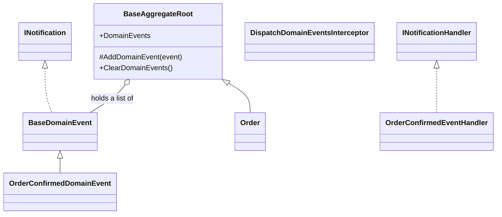
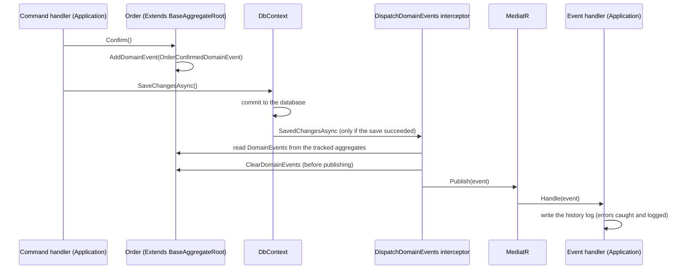

# Domain Events

> **This is a Learning example, not a production recipe.** Domain events are published after the commit and are
> best-effort: a crash loses them, and an outer transaction that rolls back after the publication leaves
> false records on MongoDB. For events that matter, write them in the same database, in the same transaction, or use an outbox.

## Classes

## Sequence

## Notes

- Interceptor must be registered in DI as scoped service and as interceptor.
- In this implementation domain events are not critical (best effort) to keep it simple, see below.
- If you need critical domain events that must not be lost you should use more complex patterns (like outbox that avoids distributed transactions)

### Criticality: three levels

| Level | Runs | Use for | Failure |
|---|---|---|---|
| Best-effort (current) | after the commit | reactions that can be lost: order history log, metrics | logged, the order stays valid |
| Same transaction | before the commit | reactions that touch **the same relational database** | the whole save fails |
| Outbox | after the commit, from a table | guaranteed reactions that involve an external system | retried until done |

Handlers run after the commit, so they are **not** part of the transaction, and they are all treated as non-critical: each one is expected to catch and log its own failures. 

If an outer transaction wraps the save, the handlers would run before its commit: we do not rely on this.

The voucher redemption is a critical step of the confirmation, not a reaction, so it stays inside the confirm command handler, in the same transaction as the order, and does not go through an event.

### Why we're not using events for critical work

The relational database and MongoDB share no transaction (there is no practical two-phase commit between them). 

If a reaction on MongoDB must not be lost and must not be done if the transaction fails, a reliable way to handle is an **outbox**:
- the interceptor should implements onsavingchanges to act before the savechanges
- the interceptor writes the events to an outbox table **inside the same transaction** as the order (it no longer publishes);
- a background service (or a separate process) reads the pending rows, runs the handlers and marks each row as processed;
- delivery is **at least once**, so handlers must be idempotent: the history log uses the event id as the document id, so a second insert of the same event is rejected instead of duplicated.

What the outbox costs: a table and a migration, serialization with type and version, a retry limit with a dead-letter table for events that keep failing, a claim mechanism so two workers do not take the same row when the app runs in several instances, and cleanup of processed rows. Not implemented here: out of scope for this project.

### Known limits of the current design

- If the process dies between the commit and the publication, the event is lost (no retry).
- Handlers run **inside the request**, so they add to its latency; the history log has its own timeout to avoid holding the request when MongoDB is slow.
- With a single sequential publisher, a failing handler prevents the following handlers of the same event from running (if not try catched).
- If an outer transaction wraps several `SaveChanges`, events would be published before the outer commit.
- The Domain references only the MediatR contracts package (`INotification`), a deliberate and small exception to a dependency-free Domain that avoids a wrapper and reflection in the dispatcher.

Compared with the reference template: it publishes events **before** `SaveChanges` (handlers share the transaction) and its events carry the entity. Here the events are published after the commit and carry a snapshot.

The history log on MongoDB is a learning exercise; in production I would store it in the relational database, in the same transaction, or use an outbox.