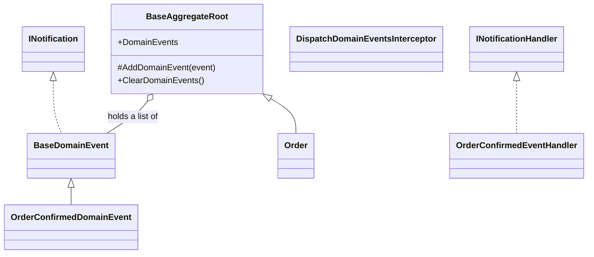
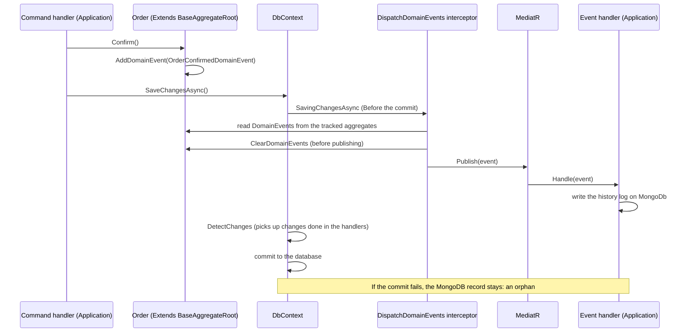

# Domain Events

> **This is a Learning example, not a complete production recipe.** Domain events are published and handled before the commit. If a handler throws, changes are not committed and you should add trycatch if it's not intended to work in this way. If the transaction is rolled back, records on mongodb are still persisted and become orphans because they're not under the same transaction. See [Criticality](#criticality-four-levels) for more info on edge cases.

## Classes

## Sequence

## Notes

- Interceptor must be registered in DI as scoped service and as interceptor
- The list property exposing the list of DomainEvents in BaseAggregateRoot must be configured as ignored in DbContext.OnModelCreating
- Handlers must not call SaveChanges: the nested call re-enters the interceptor and commits part of the work early.
- Events raised by handlers are not published in the same pass, unless the interceptor repeats the collection until the list is empty 

### Criticality: four levels

Two independent questions about each domain event:
1. **Orphan OK?** Is it acceptable that the effect appears even if the transaction is rolled back?
2. **Loss OK?** Is it acceptable that the effect is lost (crash, error)?

| Orphan OK? | Loss OK? | What to do |
|---|---|---|
| Yes | Yes | Handle Before the commit, **with** `try/catch` |
| Yes | **No**[1] | Handle Before the commit, **without** `try/catch`: if the handler fails, the save fails |
| **No**[2] | Yes | Handle **After the commit** (pay attention to external transactions) |
| **No** | **No** | Handle with Outbox, or a two-phase commit |

- [1] If your event involves changes on EF, orphans are handled for free because these changes are still under transaction. If your event involves other stores (such as MongoDb) that doesn't share automatically the same transaction of EF, then orphans will be created if the EF transaction is rolled back.
- [2] SavedChanges runs after the commit only when EF owns the transaction. If you use an outer transaction SavedChanges runs before the transaction commit, so orphans are possible. A reliable "after the commit" needs to publish from the application layer once the outermost transaction has committed. A transaction-committed hook alone is not enough, because a single-command save does not open a transaction at all.

### Outbox

If you need to add critical data, that must not be lost and must not be orphans, into a system that doesn't share the transation with EF (such as MongoDb), a reliable way to handle is an **outbox**:
- the handler writes the events to an outbox table **inside the same transaction** as the order;
- a background service (or a separate process) reads the pending rows, runs the handlers and marks each row as processed;
- delivery is **at least once**, so handlers must be idempotent: the history log uses the event id as the document id, so a second insert of the same event is rejected instead of duplicated.

What the outbox costs: a table and a migration, serialization with type and version, a retry limit with a dead-letter table for events that keep failing, a claim mechanism so two workers do not take the same row when the app runs in several instances, and cleanup of processed rows. Not implemented here: out of scope for this project.

Another way would be to implement a **two-phase commit**. Both are complex solutions. 

### Known limits of the current design

- Handlers run **inside the request**, so they add to its latency.
- With a single sequential publisher, a failing handler prevents the following handlers of the same event from running (if not try catched).
- The Domain references the MediatR contracts package (`INotification`), a deliberate and small exception to a dependency-free Domain that avoids a wrapper and reflection in the dispatcher.

Compared with the reference template: it publishes events carrying the entity. Here the events carry a snapshot.

The history log on MongoDB is a learning exercise; in production I would store it in the relational database, in the same transaction, or use an outbox.